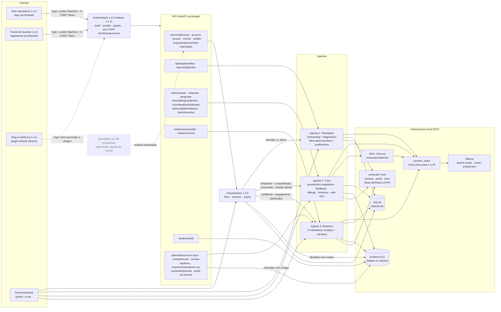

# Arquitetura do Sistema TIA (EAP 1.3.1) e Orquestração (EAP 1.3.5)

> Protótipo integrado (fatia vertical) da frente A3. Situação em 12/10/2026.
> Desde 12/10/2026 (branch `agente1-tiago`) a ementa, os perfis e o banco de itens são a **base pedagógica
> alinhada à EAP** (trilhas Dev e Defesa Cibernética sobre a base comum de Python), e o Agente 1 tem
> primeiro acesso (onboarding + diagnóstico). Resumo: `docs/relatorios/base_pedagogica_e_agente1.md`.
> Limiares e regras pedagógicas validados pela Pessoa 4 em 19/10/2026. Continuam **PROVISÓRIO** os itens que
> dependem da Pessoa 2 (agentes), e do jurídico/DEP (LGPD). Banco de itens e material do piloto: validados.

## Diagrama

Legenda: caixas com borda contínua **existem** e têm testes. Caixas tracejadas **ainda não existem**.



## O que existe e o que não existe

| Parte | Situação |
|---|---|
| LLM local (Ollama, qwen3) via `core/llm_client` | **Real** (R07: nunca API externa) |
| RAG (Chroma + nomic-embed-text) | **Real**. Material dos 4 tópicos do piloto validado pela Pessoa 4 |
| Agente 1 Planejador | **Real**: trilha (Dev/Defesa Cibernética + base comum), perfil enquadrado pelo diagnóstico, prazo e escopo do piloto, primeiro acesso (onboarding conversacional e diagnóstico; `rotas_primeiro_acesso.py`). Ementa e perfis: base alinhada à EAP (48 tópicos); limiares PROVISÓRIOS |
| Agente 2 Tutor (questionário, feedback com guarda, diálogo, incentivo, veto R12) | **Real**. Regras do 1.2.5 (3/2/3, lacuna, nível inicial). Banco de 120 itens alinhado à EAP; tópicos Dev/Cyber fora do piloto ainda sem itens e sem material |
| Agente 3 Relatório (5 indicadores, narrativa com guarda) | **Real**. Indicadores validados pela Pessoa 4 |
| Orquestrador (este documento) | **Real**. Regras validadas pela Pessoa 4 |
| Agendador da verificação de inatividade (cron/timer na VM) | **Não existe**. O comando e a rota que ele chamará existem (`python -m tia.orquestrador --verificar-inatividade`, `POST /orquestrador/verificar-inatividade`) |
| Auditoria (R11) | **Real** (tabela `auditoria`, `GET /auditoria/{id}`) |
| API FastAPI | **Real**, com autenticação e papéis (ver "Segurança") |
| Segurança e LGPD (1.4.6) | **Real**: login local, sessão no servidor (inatividade e limite absoluto), anti-CSRF, papéis aluno/docente/admin, auditoria com o usuário, política e troca obrigatória de senha, recusas agregadas, retenção (PROVISÓRIA), direitos do titular, cabeçalhos em todas as respostas, importação em lote. Login único do EBAULA pendente |
| Web standalone (1.4.4, `src/tia/web/`, em `/app`) | **Real**, com login e com visual PROVISÓRIO (ver "Web standalone" abaixo) |
| Painel do docente/instituição (1.4.5, `src/tia/web/static/painel/`, em `/app/painel`) | **Real**, com login (só docente) e com visual PROVISÓRIO (ver "Painel do docente" abaixo). A pasta `dashboard/` da raiz ficou vazia |
| Plug-in EBAULA (1.4.3, `src/tia/web/static/plugin/`, doc em `plugin-ebaula/`) | **Real, mas só testado em navegador simulado**: botão + painel com iframe do TIA, ou nova aba. Não foi testado no EBAULA de verdade (sem acesso). Exige `TIA_FRAME_ANCESTORS` no servidor |
| VM institucional (medição do R09) | **Não disponível**. Os tempos foram medidos em notebook (CPU) |

## Fluxo de dados do aluno (orquestrado)

```mermaid
sequenceDiagram
    participant C as Cliente
    participant A as Agendador (VM)
    participant O as Orquestrador
    participant P as Planejador
    participant T as Tutor
    participant R as Relatório
    participant D as SQLite + auditoria

    C->>O: POST /aluno/{id}/iniciar (perfil, diagnóstico, horas)
    O->>P: planejar_e_salvar
    O->>D: matrícula + decisão "planejar" (auditoria)
    C->>O: GET /aluno/{id}/proximo
    O-->>C: iniciar_sessao (competência atual ou reforço)
    C->>O: POST /aluno/{id}/sessao (competência)
    O->>T: iniciar_sessao, só se for a competência atual ou o reforço
    O->>D: decisão "abrir_sessao" ou "recusar_sessao" (auditoria)
    loop cada resposta
        C->>O: POST /aluno/{id}/evento (resposta, evento_id)
        O->>T: responder (feedback com RAG + LLM + guarda)
        T->>D: histórico (item_id, sessao_id) + auditoria
        alt sessão concluída
            O->>P: R1: planejar_e_salvar com as concluídas (só o que falta) + aviso
        else sessão de reforço concluída
            O->>T: retomar a sessão pausada (mesmo nível)
        else queda (tendência do Relatório)
            O->>T: R2: pausar a sessão; reforço do pré-requisito direto
        end
        O->>D: decisão com motivo e aviso (auditoria)
        O-->>C: feedback + decisões + avisos + próxima ação
    end
    A->>O: POST /orquestrador/verificar-inatividade (todos os alunos)
    O->>R: engajamento (INATIVIDADE_DIAS)
    O->>T: R3: incentivo (>= 3 dias)
    O->>P: R3: refazer a trilha (>= 14 dias)
    O->>D: decisão por aluno (auditoria)
    C->>R: GET /relatorio/aluno/{id} · /relatorio/turma (sob demanda)
```

- **Abertura de sessão no fluxo gerenciado:** `POST /aluno/{id}/sessao`. Só abre a competência atual ou
  o reforço decidido pelo orquestrador; qualquer outra é recusada (409, com o motivo) e registrada na
  auditoria (`recusar_sessao`).
- **`POST /tutor/sessao`:** continua existindo para uso **standalone** e **não passa pelo orquestrador**.
  Não confere a competência atual, não avalia regras e não vincula reforço.
- **Respostas:** vão por `POST /aluno/{id}/evento`, para o orquestrador avaliar as regras. Uma resposta
  enviada direto a `/tutor/resposta` é registrada pelo Tutor, mas não passa pelas regras. Sessão pausada
  recusa resposta nas duas rotas.
- **Veto docente (R12):** fica na rota do Tutor, `PATCH /tutor/dialogo/{id}/veto`, e aparece no fluxo por
  `GET /aluno/{id}/estado`: `dialogos_vetados` e `rotas.veto_docente`.
- **Idempotência:** cada evento tem um `evento_id`. Reenviar o mesmo id devolve o resultado gravado
  (`repetido: true`) sem chamar o Tutor nem o Planejador de novo. Se o processamento falha, a reserva
  é desfeita e o evento pode ser reenviado.

## Decisões de orquestração

Tomadas em 10/10/2026. Quem decidiu, entre parênteses. Validadas pela Pessoa 4 em 19/10/2026; os limiares ficam em `core/config.py`.

| # | Decisão | Como está implementada |
|---|---|---|
| D1 | **Replanejar só o que falta** (Pessoa 2) | `EntradaPlanejador.concluidas`: as competências concluídas entram na trilha marcadas `concluida` (horas 0, semana 0, sem justificativa do LLM) e nunca voltam a ficar pendentes. Contam como pré-requisito cumprido. Só as que faltam são agendadas, a partir da semana 1. Todo replanejamento do orquestrador passa as concluídas do Tutor **que pertencem à trilha original** (perfil + diagnóstico da matrícula, sem concluídas; `fluxo.competencias_originais`) |
| D2 | **Na queda: pausar, reforçar o pré-requisito direto a partir do nível 1 e retomar a original no nível em que parou, sem zerar** (Pessoa 2) | `tutor_sessoes.pausada` (ADD COLUMN): a sessão pausada guarda nível, item e itens usados, e recusa resposta. `orquestrador_reforcos` liga a sessão pausada à de reforço. A sessão de reforço é uma sessão nova do Tutor (nível 1). Ao concluí-la, a original é retomada (`retomar_original`) e o aluno é avisado do nível |
| D3 | **Abertura de sessão no fluxo gerenciado passa pelo orquestrador** (Pessoa 2) | `POST /aluno/{id}/sessao`. `/tutor/sessao` fica só para uso standalone |
| D4 | **Inatividade avaliada por comando/rota chamados por agendador externo** (cron/timer na VM, depois de 15/10; o agendador não faz parte deste pacote) (Pessoa 2) | `python -m tia.orquestrador --verificar-inatividade` e `POST /orquestrador/verificar-inatividade` percorrem os alunos matriculados e registram uma decisão por aluno (inclusive "nenhuma"). Rodar de novo não duplica nada. O `GET /proximo` não pede mais "replanejar" |
| D5 | **Concluir uma competência avança automaticamente e avisa o aluno.** Validado (Pessoa 4) | R1: `avancar` + aviso por template ("Parabéns! Você concluiu …. Próxima etapa: …") em `DecisaoReplanejamento.aviso` e `ResultadoEvento.avisos` |
| D6 | **Queda reforça só o pré-requisito direto.** Validado (Pessoa 4) | R2: primeiro pré-requisito da competência na ementa. Sem pré-requisito, não reforça (decisão "nenhuma"). Não há reforço do reforço |
| D7 | **Inatividade de 3 dias só retoma com incentivo, sem refazer a trilha; a trilha só é refeita após `ORQ_INATIVIDADE_REFAZER_DIAS`** (padrão 7 desde 12/10/2026; era 14; piloto 2/4). Validado (Pessoa 4) | R3: `incentivar` (mensagem do incentivo do Tutor, registrada na auditoria) a partir de `INATIVIDADE_DIAS`; `refazer_trilha` a partir de `ORQ_INATIVIDADE_REFAZER_DIAS`. Cada ação vale uma vez por período sem atividade. **Desde 11/10/2026:** quem concluiu a trilha (sem reforço em curso) não recebe incentivo, não tem a trilha refeita e sai com `inativo: false` no `estado` (mesmo critério do painel) |
| D8 | **Autenticação** (pacote 1.4.6, etapa 1, 11/10/2026) | Sessão e papéis em todas as rotas; ver "Segurança" |
| D9 | **Itens acabaram sem domínio = "concluída com ressalvas", não conclusão plena** (15/10/2026, ajuste de integração do Agente 1). Limiar validado (Pessoa 4) | O Tutor grava `tutor_sessoes.com_ressalvas` e `taxa_acerto` (ADD COLUMN) e devolve `Feedback.com_ressalvas`. A R1 só avança com acerto da sessão >= `ORQ_ACERTO_MIN_AVANCO` (0,6); abaixo, `reforcar` o pré-requisito direto **sem pausa** (a sessão já terminou) ou `revisar_material`, cada um no máximo uma vez por sessão; depois o aluno recomeça a competência numa sessão nova. Competência com ressalva abaixo do mínimo não conta no progresso, no incentivo nem no Planejador (`tutor.repositorio.CONCLUSAO_QUE_VALE`). O Relatório do aluno mostra toda ressalva; o painel alerta (`conclusao_sem_dominio`) só quando ela impediu o avanço |

### Quem pode chamar as rotas da orquestração

Matriz completa na seção "Segurança". Escrita (`iniciar`, `sessao`, `evento`) só pelo próprio aluno; leitura
(`proximo`, `estado`) pelo próprio aluno ou por um docente; `POST /orquestrador/verificar-inatividade` por
docente ou admin. O agendador da VM usa o comando (`python -m tia.orquestrador --verificar-inatividade`), que
não passa por HTTP e grava a auditoria com o papel `sistema`.

## Regras (todas em `src/tia/orquestrador/regras.py`)

| Regra | Dispara quando | Ação | Limiares (config) | Status |
|---|---|---|---|---|
| R1 conclusão | Sessão do Tutor concluída na competência (`TUTOR_ACERTOS_CONCLUIR` acertos seguidos no nível 3; 3 desde 12/10/2026), conclusão ainda não tratada. Sessão terminada porque os itens acabaram (com ressalvas): só com acerto da sessão >= `ORQ_ACERTO_MIN_AVANCO` | `avancar`: Planejador incremental (só o que falta) + aviso (o motivo cita a ressalva) | (critério de conclusão do Tutor), `ORQ_ACERTO_MIN_AVANCO=0.6` | PROVISÓRIO (D5, D9) |
| R1 sem domínio | Sessão com ressalvas e acerto abaixo de `ORQ_ACERTO_MIN_AVANCO` (`regras.regra_sem_dominio`) | Com pré-requisito direto e sessão ainda não reforçada: `reforcar` sem pausa; senão, se a sessão ainda não teve material: `revisar_material`; senão `nenhuma` (gravada com o motivo). O aluno recomeça a competência numa sessão nova | `ORQ_ACERTO_MIN_AVANCO=0.6` | PROVISÓRIO (D9) |
| R2 queda | Tendência do Relatório "caindo" (última sessão contra as anteriores; sem sessão, janela de respostas). A sessão não é de reforço e ainda não causou reforço, há respostas suficientes desde o último reforço e existe pré-requisito direto | `reforcar`: pausa + reforço do pré-requisito direto no nível 1 (sem Planejador) | `RELATORIO_TENDENCIA_LIMIAR=0.15`, `RELATORIO_TENDENCIA_MIN_RESPOSTAS=3`, `RELATORIO_TENDENCIA_JANELA=5`, `ORQ_QUEDA_RESPOSTAS_ENTRE_REPLANOS=5` | PROVISÓRIO (D6) |
| Lacuna (1.2.5) | O Tutor sinaliza `lacuna` (`TUTOR_ERROS_DESCER` erros seguidos já no nível 1). Avaliada antes da queda | Com pré-requisito direto e sessão ainda não reforçada: `reforcar` (como R2). Sem pré-requisito ou já reforçada: `revisar_material` (aviso com o material-base; a sessão segue), no máximo uma vez por sessão (desde 15/10/2026; depois, `nenhuma` e vale a R2) | `TUTOR_ERROS_DESCER=2` | PROVISÓRIO (Pessoa 4) |
| Fim do reforço | A sessão de reforço foi concluída | `retomar_original`: a sessão pausada volta no mesmo nível. Se a original já tinha terminado sem domínio (R1 sem domínio), não há o que retomar: o aviso pede para recomeçar a competência numa sessão nova | - | Decisão D2, D9 |
| R3 inatividade | Engajamento do Relatório: dias sem atividade (sem atividade: desde a trilha). Avaliada pela verificação agendada. Não vale para quem concluiu a trilha (`fluxo.trilha_concluida`) | `incentivar` (>= `INATIVIDADE_DIAS`) ou `refazer_trilha` (>= `ORQ_INATIVIDADE_REFAZER_DIAS`, Planejador incremental). Uma vez por período | `INATIVIDADE_DIAS=3`, `ORQ_INATIVIDADE_REFAZER_DIAS=7` | PROVISÓRIO (D7) |

- **Próxima ação** (`GET /proximo`), por prioridade:
  1. reforço em curso (`iniciar_sessao` ou `continuar_sessao`, com `reforco: true`);
  2. `concluido`;
  3. `continuar_sessao` (sessão aberta, não pausada, na competência atual);
  4. `iniciar_sessao` (primeira etapa pendente da trilha).
- **Decisões:** toda decisão (`planejar`, `avancar`, `reforcar`, `retomar_original`, `incentivar`,
  `refazer_trilha`, `revisar_material`, `abrir_sessao`, `recusar_sessao` ou `nenhuma`) vai para `orquestrador_decisoes` e
  para a auditoria, com a regra e o motivo no campo `motivo`.

## Tabelas acrescentadas (só CREATE TABLE / ADD COLUMN)

- `orquestrador_matriculas`: perfil, horas e diagnóstico do aluno, que o Planejador não grava
  (desde 12/10/2026 também `trilha`, `prazo_dias` e `escopo`).
- `planejador_onboarding` e `planejador_diagnosticos`: primeiro acesso (cadastro sem o texto da conversa e notas
  do diagnóstico).
- `orquestrador_eventos`: `evento_id` e resultado (idempotência).
- `orquestrador_decisoes`: regra, ação, competência, motivo, aviso, sessão, evento, se replanejou,
  origem e tempo do Planejador.
- `orquestrador_reforcos`: sessão pausada, competência e sessão de reforço, estado
  (pendente, em_andamento ou concluido).
- `tutor_sessoes.pausada`: sessão suspensa durante um reforço.
- `tutor_sessoes.com_ressalvas` e `tutor_sessoes.taxa_acerto` (15/10/2026, D9): sessão terminada porque os
  itens acabaram, sem domínio, e o acerto da sessão. NULL nas sessões antigas (= conclusão plena).
- `trilha_estudo.concluida` e `trilha_estudo.origem_justificativa`.
- `tutor_feedbacks` (11/10/2026, revisão docente R12): texto do feedback de cada resposta (veredito,
  explicação que o aluno viu, origem, falha, fontes, texto do LLM barrado pela guarda e motivo), item,
  sessão, aluno, `vetada` e `correcao_docente`. Uma linha por resposta (`resposta_id` =
  `historico_respostas.id`); respostas anteriores não têm linha e não são revisáveis.
- `auditoria.motivo`: motivo de cada decisão.
- Segurança (1.4.6): `usuarios`, `auth_sessoes`, `auth_tentativas`, `auditoria.usuario_id` e
  `auditoria.usuario_papel` (etapa 1); `usuarios.trocar_senha`, `auth_sessoes.ultimo_uso` e `auth_anonimos`
  (etapa 1b); `auditoria.anonimizada` (LGPD).

## Limitações conhecidas

- ~~Competência de reforço concluída entra na trilha~~ **Corrigido em 11/10/2026:** o replanejamento só
  recebe as concluídas que pertencem à trilha original, então o reforço de um pré-requisito dispensado
  no diagnóstico não vira etapa e o progresso e os indicadores contam só as competências originais
  (`test_reforco_concluido_nao_conta_no_progresso_da_trilha`). O reforço continua no histórico do Tutor
  (sessões, respostas, desempenho por competência).
- **Uma sessão de reforço aberta por `/tutor/sessao` (standalone)** não é vinculada ao reforço. O
  `proximo` continua pedindo para abrir o reforço por `/aluno/{id}/sessao`.
- **Base comum sem itens para o domínio (D9):** os 6 tópicos da base comum têm 2 itens por nível; com as
  regras 3/2/3, nenhum aluno chega a 3 acertos seguidos no nível 3. Toda conclusão neles é "com ressalvas" e
  o avanço depende só do acerto da sessão (`ORQ_ACERTO_MIN_AVANCO`). Resolve-se com mais itens (Pessoa 4).
- **Recomeço sem limite:** quem não atinge o mínimo recomeça a competência numa sessão nova, e cada sessão
  pode ter de novo um reforço e um material. Não há limite de tentativas nem encaminhamento automático ao
  docente além do alerta do painel (pendência para a Pessoa 4).
- **Sem agendador:** até a VM, a verificação de inatividade só acontece quando alguém roda o comando ou
  chama a rota.
- ~~Sem autenticação (D8)~~ **Resolvido na etapa 1 do 1.4.6** (ver "Segurança").

## Web standalone (EAP 1.4.4)

HTML, CSS e JavaScript puros em `src/tia/web/static/` (sem Node, framework ou build), servidos pelo
próprio FastAPI em **`/app/`** (`tia.web.montar`). O caminho segue o pedido da tarefa (dentro do pacote,
para ir junto no `pip install`); a pasta `web/` da raiz ficou vazia.

| Arquivo | Papel |
|---|---|
| `static/index.html` | as cinco telas, com rótulos, região de status e foco |
| `static/tema.css` | **só variáveis** de cor, fonte e espaçamento (claro e escuro). Trocar pelo visual do EBAULA = trocar este arquivo |
| `static/estilo.css` | layout responsivo; usa só as variáveis do tema (teste confere que não há cor fixa) |
| `static/app.js` | chamadas à API e montagem das telas; texto da API sempre por `textContent` |
| `__init__.py` | monta `/app` e põe cabeçalhos de segurança (CSP só com a própria origem, `nosniff`, `no-referrer`) |
| `dados_demo.py` | `python -m tia.web.dados_demo`: alunos fictícios DEMO-W01..W03 |

### Telas e rotas consumidas

| Tela | O que mostra | Rotas |
|---|---|---|
| Login / entrada | login com usuário e senha (1.4.6); o código do aluno vem da sessão. Só no modo de desenvolvimento (`TIA_AUTH=desligada`, com aviso): código do aluno validado com o padrão do R08. Código sem matrícula abre o formulário de matrícula (perfil e horas; diagnóstico vazio) | `GET /aluno/{id}/estado` (404 = sem matrícula), `POST /aluno/{id}/iniciar` |
| Trilha | etapas em ordem, etapa atual destacada, concluídas marcadas, horas e semana, justificativa do Planejador com a origem (LLM ou texto padrão), origem e falha do último planejamento, aviso da última decisão e reforço em curso | `GET /aluno/{id}/estado`, `GET /alunos/{id}/trilha` |
| Estudo | uma pergunta por vez com alternativas (rádio), envio, veredito fixo, explicação com a origem (LLM, guarda ou fallback) e o motivo da falha, fontes citadas (R03), nível, avisos do orquestrador (conclusão, reforço, retomada, incentivo). Abre a sessão só pelo orquestrador | `GET /aluno/{id}/proximo`, `POST /aluno/{id}/sessao`, `POST /aluno/{id}/evento` |
| Perguntar ao tutor | pergunta livre (até 500 caracteres, filtro por competência da trilha), resposta com origem: `LLM` (ancorada no material, com fontes), `guarda` (trecho do material transcrito, com a fonte) ou `fallback` (mensagem fixa quando o material não cobre). Histórico com as correções do docente (R12) | `POST /tutor/perguntar`, `GET /alunos/{id}/dialogo` |
| Meu relatório | os 5 indicadores em linguagem simples; o resumo (narrativa do LLM) só quando o aluno pede, porque leva até um minuto | `GET /relatorio/aluno/{id}?narrativa=false` e `?narrativa=true` |

Comportamento comum: durante uma chamada, faixa "Aguardando…" com contador de segundos (`role=status`),
botões de ação desativados e a página continua navegável. Espera máxima no navegador: 300 s (uma resposta
pode acionar Tutor e Planejador, 120 s cada no servidor). Estouro de tempo, falta de conexão e erros da
API aparecem numa faixa de erro (`role=alert`) com o `detail` da API. Uma resposta que falhou por rede é
reenviada com o **mesmo `evento_id`** (o orquestrador não processa duas vezes). Nada vai para o console;
o código do aluno fica só no `sessionStorage` da aba (para sobreviver a recarregar a página).

### Mudança na API (indispensável)

- `ProximaAcao.pergunta` (opcional, preenchida só em `continuar_sessao`, por `fluxo.proxima`): a pergunta
  em aberto da sessão, sem gabarito. **Motivo:** nenhuma rota devolvia a pergunta de uma sessão já
  aberta. Depois de recarregar a página, de voltar outro dia ou na retomada após um reforço (a última
  resposta do reforço traz `proxima_pergunta = null`), o aluno ficava preso: `POST /aluno/{id}/sessao`
  recusa (409, "continue-a") e o cliente não tinha a pergunta. O campo é opcional, então os clientes
  atuais não mudam.

### O que falta

- ~~Login (1.4.6)~~ **Feito (etapa 1):** o aluno entra com usuário e senha e o código vem da sessão. A entrada
  pelo código só existe no modo de desenvolvimento (`TIA_AUTH=desligada`).
- **Visual do EBAULA:** cores, fontes, logotipo e componentes. Basta trocar `tema.css` (e, se preciso,
  ajustar `estilo.css`); a estrutura HTML usa classes neutras.
- **Plug-in EBAULA (1.4.3):** feito (`plugin-ebaula/README.md`). A CSP continua `frame-ancestors 'none'`
  em toda a API; só as páginas `/app` liberam as origens listadas em `TIA_FRAME_ANCESTORS` (vazio = ninguém).
  Falta validar no EBAULA real (cookies `SameSite=Strict` só funcionam se TIA e EBAULA forem do mesmo site).
- **Diagnóstico na matrícula:** a tela não pergunta o diagnóstico (todas as notas 0). Depende de quem
  aplica o diagnóstico (Pessoa 2/4).
- **Nomes de competência fora da trilha:** o reforço de um pré-requisito dispensado aparece pelo código
  (ex.: `repeticao`) no cartão de revisão; o aviso do orquestrador já traz o nome. A rota da ementa agora
  existe (`GET /conteudo/ementa`, criada para o painel); falta o `app.js` usá-la.
- **Roteiro de navegador automatizado:** o Playwright não está instalado; ver
  `docs/relatorios/web_standalone.md`.

## Painel do docente/instituição (EAP 1.4.5)

HTML, CSS e JavaScript puros em `src/tia/web/static/painel/`, servidos em **`/app/painel/`** pelo mesmo
`tia.web.montar` (mesma CSP, sem script inline). Reaproveita `tema.css`, `estilo.css` e o novo `comum.js`
(utilidades extraídas de `app.js`: `el`/`svg` com `textContent`, `chamar` com contador de segundos e botões
`.acao` desativados, faixa de erro). As consultas ficam em `src/tia/painel/` (só leitura) e as rotas em
`tia.api.rotas_painel`. Dados de demonstração: `python -m tia.web.dados_painel` (12 alunos DEMO-P01..P12, sem LLM).

### Telas e rotas consumidas

| Tela | O que mostra | Rotas |
|---|---|---|
| Visão geral | os 5 indicadores agregados do Agente 3 em cartões (progresso médio, acerto por nível, engajamento, pontos fracos, origem dos feedbacks e taxa de veto), alertas da turma só com contagens, regra do grupo mínimo explicada e a interpretação com a origem (LLM, guarda ou fallback) só quando o docente pede. Filtro por perfil no topo. Exportar CSV e Imprimir | `GET /relatorio/turma?narrativa=false` e `?narrativa=true`, `GET /painel/exportar/indicadores.csv` |
| Alertas de risco | alunos em risco **com código** (nunca nome): inatividade, desempenho em queda, desempenho baixo, competência terminada sem domínio e sem acerto para avançar (D9), com o motivo em texto, dias sem atividade, acerto, tendência e progresso. Só docente; o rodapé avisa que cada consulta fica na auditoria em nome dele. Cada consulta grava `consulta_painel` na auditoria com os códigos exibidos. Atalho para a auditoria do aluno | `GET /painel/alunos-em-risco` |
| Competências | barras SVG da taxa de acerto por competência (linha de referência em 50%), contagem de alunos por tendência e questões com erro repetido (com enunciado) | `GET /painel/competencias` |
| Revisão docente (R12) | feedbacks das questões e respostas do diálogo com o texto original, a questão ou a pergunta, o veredito, a origem, as fontes, o texto barrado pela guarda e a correção; filtros por tipo, situação, origem e competência; Aprovar, Vetar (com a correção/motivo) e Retirar veto; taxa de vetos de cada tipo | `GET /painel/revisao`, `PATCH /tutor/dialogo/{id}/veto`, `PATCH /tutor/feedback/{id}/veto` |
| Auditoria (R11) | tabela filtrável por agente (orquestrador, planejador, tutor, relatório, painel), código do aluno e período, paginada (25 por página) | `GET /painel/auditoria` |

Todas as telas: carregamento com contador de segundos (`role=status`), botões desativados durante a
chamada, erro com o `detail` da API (`role=alert`), aba atual no endereço (`/app/painel/#risco`). CSS de
impressão: só a tela aberta, sem abas nem botões, sempre no tema claro (cores de impressão em `tema.css`).

### Rotas novas (somente leitura)

| Rota | Devolve | Observação |
|---|---|---|
| `GET /conteudo/ementa` | competências (id, nome, pré-requisitos) | Validado (Pessoa 4). Resolve também a pendência da web do aluno |
| `GET /conteudo/perfis` | perfis (id, nome) | Validado (Pessoa 4) |
| `GET /painel/alunos-em-risco?perfil_id=` | `ConsultaRisco` com códigos | **auditada** a cada chamada |
| `GET /painel/competencias?perfil_id=` | `DesempenhoCompetencias` | só agregados (usa `indicadores.agregar_turma`) |
| `GET /painel/revisao?situacao=&origem=&pagina=&por_pagina=` | `ListaRevisao` | **auditada**; mostra códigos e textos do diálogo |
| `GET /painel/auditoria?agente=&aluno_id=&desde=&ate=&pagina=&por_pagina=` | `PaginaAuditoria` | mais recente primeiro; `planejador` = decisões que acionaram o Planejador |
| `GET /painel/exportar/indicadores.csv?perfil_id=` | CSV `;`, vírgula decimal, UTF-8 com BOM | sem códigos; células que começam com `= + - @` levam `'` (sem fórmula) |

Escrita: só a rota do veto que já existia. **Mudanças no que existia:** (1) `vetar_dialogo` passou a gravar
`veto_docente` na auditoria na mesma transação (`origem` = `vetada` ou `aprovada`; motivo "resposta vetada
e corrigida", "veto retirado" ou "resposta aprovada"; sem o texto da correção). **Aprovar** = `PATCH` com
`vetada: false` numa resposta sem veto: não muda a resposta, só fica registrado na auditoria, e é assim que a
revisão sabe o que já foi revisado. (2) Tipos novos na auditoria: `veto_docente` e `consulta_painel`
(`auditoria.TIPOS` e `RegistroAuditoria`). (3) `auditoria.registrar` devolve o id. (4) Configuração nova:
`PAINEL_DESEMPENHO_BAIXO=0.5` e `PAINEL_MIN_RESPOSTAS=5` (validados).

### Regras de privacidade (R08)

- Visões agregadas (visão geral, competências, CSV): mesma regra do Agente 3. Grupo inteiro abaixo de
  `RELATORIO_MIN_GRUPO` (5) não mostra nada; competência, nível ou contagem abaixo disso sai "menos de 5";
  questões com erro repetido só entram se respondidas por pelo menos 5 alunos. Nenhum código de aluno.
  O filtro por perfil "iniciante" da turma de demonstração (4 alunos) mostra o grupo suprimido.
- Alertas de risco e revisão: mostram códigos (é o que o docente precisa para agir), nunca nomes, e cada
  consulta vai para a auditoria com os códigos exibidos.

### O que é real e o que depende de outras entregas

| Parte | Situação |
|---|---|
| Telas, rotas, auditoria das consultas, veto/aprovação, CSV, impressão | **Real**, com testes (`tests/test_painel.py`) |
| Critérios de risco e indicadores | Validados pela Pessoa 4: limiares em `core/config.py` |
| Login (1.4.6) | **Feito (etapa 1):** papel docente em `/painel/*`, `/relatorio/turma` e no veto; a auditoria grava o usuário. **Falta:** restringir o docente às turmas dele (não existe turma no banco) |
| Turma | **Não existe no banco**: o grupo é a instituição inteira ou um perfil (como no Agente 3) |
| Visual do EBAULA | PROVISÓRIO: basta trocar `tema.css`; as classes são neutras. Embutir no EBAULA exige liberar o domínio em `frame-ancestors` |
| Texto do feedback das questões | **Gravado desde 11/10/2026** (`tutor_feedbacks`) e revisável como o diálogo (ver "Feedback revisável" abaixo). Respostas anteriores ficam sem texto |
| Teste de navegador automatizado | Não há (sem Playwright). As cinco telas, a impressão (PDF) e a largura de celular foram conferidas no Chrome headless com a turma fictícia |

## Feedback revisável (R12) e amostra para avaliação

Desde 11/10/2026 o Tutor grava o texto de cada feedback de questão (`tutor_feedbacks`, na mesma transação da
resposta e da auditoria), e o docente pode aprovar ou vetar esse texto do mesmo jeito que o diálogo.

| Rota | O que faz |
|---|---|
| `PATCH /tutor/feedback/{resposta_id}/veto` | mesmo corpo do veto do diálogo (`vetada`, `correcao_docente` obrigatória ao vetar). Aprovar = `vetada: false` numa resposta sem veto. Cada uso grava `veto_docente` na auditoria com referência `feedback:<id>` (a do diálogo continua só o id). 404 para resposta sem texto gravado |
| `GET /alunos/{aluno_id}/feedbacks` | feedbacks do aluno como ele vê: vetado sai com a correção do docente, sem fontes, origem `docente`. Nunca mostra o texto barrado pela guarda. A aplicação do aluno mostra os vetados em "Meu relatório", seção "Correções do professor" |
| `Feedback.resposta_id` (resposta de `/tutor/resposta` e do evento) | id para o veto; campo novo, opcional |
| `GET /painel/revisao` | lista única de feedbacks e respostas do diálogo, com o texto original, a pergunta ou o enunciado, o veredito, a origem, as fontes, o texto do LLM barrado pela guarda (só feedback) e a correção. Filtros: `tipo`, `situacao`, `origem`, `competencia_id`. Resumo e taxa de veto separados por tipo |

**LGPD:** o texto fica só em `tutor_feedbacks` e `tutor_dialogo`, e só aparece na revisão do painel (auditada),
no histórico do próprio aluno e na amostra exportada. O Agente 3 lê apenas a marca `vetada`, para o indicador 5
(`feedbacks_com_texto`, `feedbacks_vetados`, `taxa_veto_feedback`). As visões agregadas não leem o texto (teste
`test_texto_nunca_aparece_nas_visoes_agregadas`).

**Amostra:** `python -m tia.painel.amostra --n 100` sorteia, com semente fixa (padrão 2026), até N textos de
origem `LLM` (feedback e diálogo), estratificados por competência. Grava um CSV em `data/avaliacao/` (fora do
git), com as colunas "adequado (S/N)" e "observacao" vazias, e registra a exportação na auditoria. O protocolo
está em `docs/avaliacao/protocolo_amostra.md`.

**Limitação:** um evento reenviado com o mesmo `evento_id` devolve o resultado gravado na hora, com o texto
original mesmo que o docente já tenha vetado o feedback. O reenvio só acontece segundos depois da resposta
original, por falha de rede; a correção continua visível no histórico.

## Segurança (EAP 1.4.6, etapas 1 e 2)

Pacote `src/tia/seguranca/`, rotas em `tia.api.rotas_auth`. Só biblioteca padrão e FastAPI: `hashlib.scrypt`,
`secrets`, `hmac`, `sqlite3`. Implantação e impacto do `SameSite=Strict` no EBAULA:
`docs/seguranca/implantacao.md`.

### Como funciona

| Peça | Implementação |
|---|---|
| Usuários | tabela `usuarios`: `id` (código de login, nunca nome; mesmo padrão do código de aluno), `papel` (`aluno`, `docente`, `admin`), `aluno_id` (só no papel aluno), `senha_hash` (scrypt n=2^14, r=8, p=1, sal de 16 bytes por senha), `ativo`. Gestão por `python -m tia.seguranca.usuarios criar\|desativar\|redefinir-senha\|listar` (senha pelo terminal sem eco ou por `--senha-stdin`, nunca na linha de comando) ou por `/admin/usuarios` (papel admin). Não há tela de administração |
| Política de senha | `seguranca.senhas.validar`, configurável (PROVISÓRIO): pelo menos `AUTH_SENHA_MINIMA` (10) caracteres; recusa as senhas mais comuns (`seguranca/senhas_comuns.txt` mais o arquivo opcional `AUTH_SENHAS_COMUNS_EXTRA`; ignora maiúsculas e os números e símbolos das pontas, então "Senha@2026!" cai em "senha"; `AUTH_SENHA_BLOQUEAR_COMUNS=0` desliga), senha que contém o id do usuário e senha com menos de 4 caracteres diferentes |
| Senha temporária | toda senha criada ou redefinida pelo admin (comando ou `/admin/usuarios`) é temporária (`usuarios.trocar_senha`). No login, `usuario.trocar_senha` vem `true` e a sessão só aceita `POST /auth/senha` e `POST /auth/logout`; as outras rotas respondem 403 "Troque a senha temporária antes de continuar." As telas mostram o formulário de troca. `POST /auth/senha {senha_atual, nova_senha}` confere a atual (errar conta como falha de login, com o mesmo bloqueio), aplica a política, exige senha diferente, encerra todas as sessões do usuário e abre uma nova. Também serve para a troca voluntária (sem tela, por enquanto). Com provedor externo, 409. Os usuários fictícios de demonstração não têm senha temporária |
| Login | `POST /auth/login {login, senha}` pelo provedor configurado (`AUTH_PROVEDOR`). Mesma mensagem para usuário inexistente, senha errada ou usuário desativado, e o mesmo tempo de resposta (hash fictício) |
| Sessão | no servidor (`auth_sessoes`): o cookie `tia_sessao` leva um token aleatório de 256 bits e a tabela guarda só o SHA-256 dele. `HttpOnly`, `SameSite=Strict`, `Secure` configurável (`AUTH_COOKIE_SEGURO`, padrão ligado; os navegadores aceitam em `http://localhost`), `Path=/`. Expira após `AUTH_SESSAO_INATIVIDADE_MINUTOS` (30) sem nenhum pedido (`auth_sessoes.ultimo_uso`, regravado no máximo uma vez por minuto) e, mesmo em uso, `AUTH_SESSAO_MAXIMA_MINUTOS` (480) após o login. `POST /auth/logout` apaga a sessão; desativar o usuário ou trocar a senha encerra todas as sessões dele |
| Anti-CSRF | toda escrita (POST, PATCH...) exige o cabeçalho `X-CSRF-Token` igual ao token da sessão (comparação em tempo constante). O front recebe o token no login ou em `GET /auth/eu` e o guarda só em memória. No login, que ainda não tem sessão, o cabeçalho só precisa existir: um site de terceiros não consegue mandá-lo sem CORS, e a API não libera CORS. Junto com `SameSite=Strict` |
| Tentativas | `auth_tentativas` (login, IP, sucesso; nunca a senha). Bloqueio (429) com `AUTH_MAX_FALHAS_USUARIO` (5) falhas do mesmo login desde o último sucesso dele, ou `AUTH_MAX_FALHAS_IP` (20) falhas do mesmo IP, dentro de `AUTH_JANELA_MINUTOS` (15). Atraso de `AUTH_ATRASO_SEGUNDOS` (1 s) em cada falha e em cada bloqueio. Cada falha vai para a auditoria; o bloqueio, agregado como os pedidos sem login |
| Pedidos sem login | `seguranca.anonimos`: os 401 de quem não tem sessão e os 429 de login bloqueado são contados em `auth_anonimos` por origem (IP), janela fixa de `AUTH_ANONIMOS_JANELA_MINUTOS` (10) e tipo. Só o primeiro de cada origem na janela vai para a auditoria, e no máximo `AUTH_ANONIMOS_MAX_ORIGENS` (50) origens por janela. Fechada a janela, uma linha `resumo_anonimos` grava o total de pedidos e de origens e quantos foram registrados um a um. Recusas de quem está logado (403) continuam uma a uma |
| Retenção e limpeza | `seguranca.limpeza`: apaga as sessões vencidas e, depois de `AUTH_RETENCAO_IP_DIAS` (30, PROVISÓRIO), as tentativas e as contagens de pedidos sem login, as únicas tabelas com IP. O IP nunca vai para a auditoria. A API limpa ao subir e a cada `AUTH_LIMPEZA_MINUTOS` (60; 0 desliga); também por `python -m tia.seguranca.limpeza` (cron). Cada limpeza que apaga algo grava `limpeza_retencao` com as quantidades |
| Autorização | dependências de `seguranca.acesso`: `usuario_atual` (401 sem sessão; 403 sem anti-CSRF), `exigir_papel`, `acesso_ao_aluno` (`{aluno_id}` do caminho) e `conferir_aluno` (`aluno_id` do corpo). Toda recusa responde com mensagem clara e grava `acesso_negado` com a rota |
| Auditoria | colunas `usuario_id` e `usuario_papel` em toda linha: o usuário da sessão (`core.auditoria.USUARIO_ATUAL`, por requisição); `sistema` fora de requisição (comandos, agendador); `anonimo` em login recusado e 401; `sem_login` no modo de desenvolvimento. Tipos novos: `login`, `login_falha`, `login_bloqueado`, `logout`, `acesso_negado`, `gestao_usuario`, `resumo_anonimos`, `limpeza_retencao`, `retencao`, `direito_titular`. Coluna `anonimizada`: linha cujos códigos a retenção já trocou por `[anonimizado]`. Nunca a senha; o login digitado só entra se tiver o formato de código (um nome digitado por engano vira "fora do formato") |

### Quem pode chamar o quê

| Rotas | aluno | docente | admin | sem login |
|---|---|---|---|---|
| `POST /aluno/{id}/iniciar \| sessao \| evento`, `POST /tutor/sessao \| resposta \| perguntar`, `POST /planejador/trilha`, `GET /tutor/incentivo/{id}` | só o próprio (`aluno_id` do caminho ou do corpo) | 403 | 403 | 401 |
| `GET /aluno/{id}/estado \| proximo`, `GET /alunos/{id}/trilha \| dialogo \| feedbacks`, `GET /relatorio/aluno/{id}` | só o próprio | sim (leitura) | 403 | 401 |
| Primeiro acesso (Agente 1): `POST /aluno/{id}/onboarding/iniciar \| mensagem`, `POST /aluno/{id}/diagnostico/iniciar \| responder`, `POST /aluno/{id}/primeiro-acesso/concluir` | só o próprio, com o token anti-CSRF | 403 (não age pelo aluno) | 403 | 401 |
| `GET /aluno/{id}/primeiro-acesso` | só o próprio (com o objetivo) | sim, **sem o objetivo** (texto livre do aluno, R08) | 403 | 401 |
| `/painel/*`, `GET /relatorio/turma`, `GET /auditoria/{id}`, `PATCH /tutor/dialogo/{id}/veto`, `PATCH /tutor/feedback/{id}/veto` | 403 | sim | 403 | 401 |
| `POST /orquestrador/verificar-inatividade` | 403 | sim | sim | 401 |
| `GET /conteudo/ementa \| perfis` | sim | sim | sim | 401 |
| `/admin/usuarios` | 403 | 403 | sim | 401 |
| `POST /auth/senha`, `POST /auth/logout` | sim | sim | sim | 401 |
| `/auth/login`, `/auth/eu`, `/health`, `/app/*` (arquivos estáticos) | públicas | | | |
| `/docs`, `/openapi.json` | só com `API_DOCS=1` (padrão em `TIA_AMBIENTE=desenvolvimento`); em produção, 404 | | | |

O admin só gerencia usuários: não vê dados de aluno nem o painel (minimização, R08).

### Interface

`/app/` e `/app/painel/` abrem na tela de login quando não há sessão. Logado, o topo mostra "Conectado:
<usuário> (papel)" e o botão Sair; o aviso de protótipo saiu. O aluno só vê os próprios dados (o código vem
da sessão) e um docente que entra em `/app/` recebe o endereço do painel. O painel recusa quem não é
docente. Uma sessão que vence no meio do uso (inatividade ou limite) volta para o login ("Sua sessão
terminou"). Com senha temporária, a tela de login vira "Troca da senha temporária" (atual, nova e repetição;
os campos são limpos depois de cada tentativa) e só segue depois da troca. O JavaScript nunca
lê o cookie, a senha é apagada do campo depois de cada tentativa e todo texto da API entra por `textContent`.

### Provedor trocável (contrato `Autenticador`, para o login único do EBAULA)

`seguranca.autenticador`: um provedor tem `nome` e `autenticar(credenciais: dict) -> Usuario | None`. Ele
recebe as credenciais do provedor e devolve o usuário do TIA (id, papel, aluno_id) se forem válidas e o
usuário estiver ativo; senão devolve `None`, sem dizer o porquê. Não grava credencial e não abre sessão.
Sessão, anti-CSRF, limite de tentativas, papéis e auditoria não dependem do provedor. Para o EBAULA:
escrever a classe, registrá-la em `PROVEDORES` e usar `AUTH_PROVEDOR=<nome>`. O teste
`test_provedor_trocavel` faz isso com um provedor falso.

### Modo de desenvolvimento

`TIA_AUTH=desligada` (exige `TIA_AMBIENTE=desenvolvimento`; em produção a API não sobe): nenhuma rota pede
login, a auditoria grava `sem_login` e as duas telas mostram
"Modo de desenvolvimento: autenticação desligada". **Padrão: ligada.** Os testes que verificam os agentes
pelas rotas usam esse modo (fixture `auth_desligada` no `conftest`); os de segurança (`test_seguranca.py`
e `test_seguranca_etapa2.py`) ligam a autenticação. `python -m tia.web.dados_demo` e `python -m tia.web.dados_painel` criam os alunos
DEMO-W01, DEMO-W02 e DEMO-W03 e o docente DEMO-DOCENTE com uma senha de demonstração **fictícia e pública**, impressa pelo
próprio comando. Só serve para a máquina de desenvolvimento.

### LGPD e segurança geral (etapa 2 de 2)

Detalhes, inventário dos dados pessoais, bases legais propostas e pontos de rede em `docs/seguranca/lgpd.md`;
lista de conferência da VM em `docs/seguranca/implantacao.md`.

| Peça | Implementação |
|---|---|
| Retenção (C1) | `python -m tia.seguranca.retencao --simular\|--aplicar`. Prazos PROVISÓRIOS em `core/config.py`: `RETENCAO_FEEDBACK_TEXTO_DIAS` (180: textos do feedback e eventos guardados), `RETENCAO_DIALOGO_DIAS` (180: diálogo sem texto e sem aluno), `RETENCAO_RESPOSTAS_DIAS` (365: respostas, feedbacks, sessões, decisões e reforços desvinculados do aluno), `RETENCAO_AUDITORIA_DIAS` (730: auditoria **nunca apagada**, só os códigos anonimizados) e `RETENCAO_COPIAS_DIAS` (30). Reaproveita `seguranca.limpeza.aplicar` (sessões e IPs). A simulação roda tudo numa transação e a desfaz; aplicar copia o banco antes (`COPIAS_DIR`, 700/600) e grava `retencao` na auditoria |
| Anonimizar | `seguranca.anonimizacao`: `aluno_id`, `sessao_id` e `evento_id` viram NULL e os textos livres também; na auditoria, os códigos de aluno e de usuário (colunas, `login=...`, rotas, motivos) viram `[anonimizado]`. As linhas sem dono saem da lista de revisão e dos indicadores por aluno do Agente 3, mas continuam nas contagens por item, origem e veto |
| Direitos do titular (C2) | `python -m tia.seguranca.titular exportar --aluno ID` (JSON, 600, sem dados de outras pessoas) e `eliminar --aluno ID` (confirmação explícita, cópia do banco, apaga cadastro/matrícula/trilha/sessões/eventos, desvincula e apaga textos, anonimiza a auditoria, desativa o usuário; registro `direito_titular` sem o código, com protocolo) |
| Minimização (C3) | erro 422 sem o valor enviado (handler em `tia.api.main`); log do feedback barrado só com o tipo do motivo; telemetria do Chroma desligada (`rag.retrieve.abrir_cliente`); revisão sem linhas anonimizadas; testes de rotas agregadas sem códigos e do prompt da narrativa da turma |
| Cabeçalhos (D1) | middleware em `tia.api.main`: CSP, `X-Content-Type-Options: nosniff` e `Referrer-Policy: no-referrer` em toda resposta (CSP de `tia.web` em `/app`; `default-src 'none'` e `Cache-Control: no-store` na API) |
| Produção (D1) | `TIA_AMBIENTE=producao` (padrão): `/docs` desligado e a API não sobe com `TIA_AUTH=desligada`, cookie sem `Secure` ou `OLLAMA_URL` fora da máquina ou da rede interna (`config.problemas_de_configuracao`) |
| Login recusado (D4) | `login_falha` também agregado por origem e janela (`seguranca.anonimos`); o resumo conta os logins diferentes; o bloqueio continua contando cada falha |
| Importação em lote (E6) | `python -m tia.seguranca.usuarios importar --arquivo usuarios.csv`: confere tudo antes (aborta sem criar nada), senhas temporárias aleatórias (`secrets`) só no arquivo de saída (600, nunca sobrescreve), troca obrigatória no primeiro acesso |

### Pendências

- Login único do EBAULA (1.4.3): o provedor, o mapeamento usuário do EBAULA → papel/aluno_id e a forma de
  sessão dentro do EBAULA (`SameSite=Strict` não funciona em iframe de outro site; alternativas em
  `docs/seguranca/implantacao.md`).
- Docente restrito às próprias turmas (não existe turma no banco).
- Tela de administração de usuários e tela de troca voluntária de senha (hoje: comando, `/admin/usuarios` e
  `POST /auth/senha`).
- HTTPS na VM (o cookie `Secure` depende disso) e a lista de conferência de `docs/seguranca/implantacao.md`.
- Política de senha, prazos de retenção e bases legais da instituição (valores atuais PROVISÓRIOS; jurídico/DEP).
- Evento de fim do vínculo (fim do curso) que dispara a eliminação do cadastro e da trilha.
- `pip-audit` não disponível na máquina de desenvolvimento: varredura de dependências na VM.


## Implantação na VM (EAP 1.4.1)

Passo a passo, tempos, o que exige root e rede, e como reverter: `docs/implantacao_vm.md`. Resumo das peças:

| Peça | Implementação |
|---|---|
| Modelos | `MODELOS_LLM` (lista baixada e medida) e `MODELO_PADRAO` (o que os agentes usam; `CHAT_MODEL` é o nome antigo, ainda aceito). `llm_client.usar_modelo(nome)` troca o padrão dentro de um bloco (medição) |
| Raciocínio | `RACIOCINIO_POR_MODELO` (`padrão=modo;...`, primeiro que casar): `prompt` (`/nothink`), `api` (`think: false`), `prompt+api` (Qwen3) ou `nada`. `llm_client.remover_raciocinio` tira `<think>`, `<thinking>` e `<reasoning>` (bloco completo, só o fechamento, ou aberto e cortado) **antes** das guardas e dos limites de tamanho dos agentes. `coletar_chamadas()` registra, por chamada, tempo, raciocínio no texto ou pela API, corte por limite de tokens, resposta vazia e falha |
| Pacote | `deploy/preparar_pacote.sh` (máquina de desenvolvimento, com rede) gera código, wheels de `deploy/requirements.lock` e SHA256SUMS; `deploy/instalar.sh` instala **sem rede** (`pip --no-index`), com versões lado a lado em `/srv/tia/versoes` e `atual`/`anterior` para reverter |
| Serviços | `deploy/systemd/`: `tia-api.service` (127.0.0.1:8000, `--proxy-headers`, `--no-access-log`, endurecido) e timers de limpeza, inatividade (R3), retenção em simulação e backup; ajuste do Ollama para 127.0.0.1 |
| Rede | o único passo com rede na VM é `deploy/modelos.sh` (`ollama pull`), isolado e marcado; `verificar.sh` acusa conexões de saída inesperadas (`/proc/net/tcp`) |
| Backup | `tia.implantacao.backup` (`deploy/backup.sh` e `restaurar.sh`): SQLite pela API de backup, índice do Chroma em tar, `.env` à parte, 700/600, rotação por `BACKUP_DIAS`; a restauração confere SHA256 e integridade e não apaga nada |
| Fumaça e R09 | `tia.implantacao.verificar` (`deploy/verificar.sh`): configuração, banco, API e cabeçalhos, login, Ollama, Chroma, rede; `--medir-r09 N` grava CSV por interação e resume por modelo e tipo (média, p50, p90, p95, fração ≤ 15 s, descartes, fallbacks, vazias, cortadas, raciocínio vazando) |
