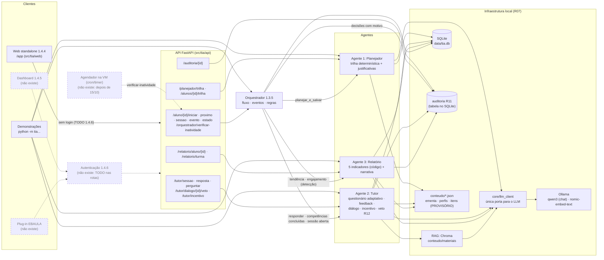

# Arquitetura do Sistema TIA (EAP 1.3.1) e Orquestração (EAP 1.3.5)

> Protótipo integrado (fatia vertical) da frente A3. Situação em 11/10/2026.
> Dados pedagógicos (ementa, perfis, banco de itens, material) e regras marcadas como
> **PROVISÓRIO** dependem da Pessoa 2 (agentes) e da Pessoa 4 (conteúdo).

## Diagrama

Legenda: caixas com borda contínua **existem** e têm testes. Caixas tracejadas **ainda não existem**.



## O que existe e o que não existe

| Parte | Situação |
|---|---|
| LLM local (Ollama, qwen3) via `core/llm_client` | **Real** (R07: nunca API externa) |
| RAG (Chroma + nomic-embed-text) | **Real**. O material é PROVISÓRIO (Pessoa 4) |
| Agente 1 Planejador | **Real**. Ementa e perfis são PROVISÓRIOS |
| Agente 2 Tutor (questionário, feedback com guarda, diálogo, incentivo, veto R12) | **Real**. O banco de itens é PROVISÓRIO |
| Agente 3 Relatório (5 indicadores, narrativa com guarda) | **Real**. Os indicadores são PROVISÓRIOS |
| Orquestrador (este documento) | **Real**. As regras são PROVISÓRIAS |
| Agendador da verificação de inatividade (cron/timer na VM) | **Não existe**. O comando e a rota que ele chamará existem (`python -m tia.orquestrador --verificar-inatividade`, `POST /orquestrador/verificar-inatividade`) |
| Auditoria (R11) | **Real** (tabela `auditoria`, `GET /auditoria/{id}`) |
| API FastAPI | **Real**, **sem autenticação** (TODO 1.4.6 nas rotas) |
| Autenticação de aluno/docente (1.4.6) | **Não existe** |
| Web standalone (1.4.4, `src/tia/web/`, em `/app`) | **Real**, sem login e com visual PROVISÓRIO (ver "Web standalone" abaixo) |
| Dashboard institucional (1.4.5, `dashboard/`) | **Não existe**. Vai consumir o JSON de `/relatorio/...` |
| Plug-in EBAULA (`plugin-ebaula/`) | **Não existe** |
| VM institucional (medição do R09) | **Não disponível**. Os tempos foram medidos em notebook (CPU) |

## Fluxo de dados do aluno (orquestrado)

```mermaid
sequenceDiagram
    participant C as Cliente
    participant A as Agendador (VM)
    participant O as Orquestrador
    participant P as Planejador
    participant T as Tutor
    participant R as Relatório
    participant D as SQLite + auditoria

    C->>O: POST /aluno/{id}/iniciar (perfil, diagnóstico, horas)
    O->>P: planejar_e_salvar
    O->>D: matrícula + decisão "planejar" (auditoria)
    C->>O: GET /aluno/{id}/proximo
    O-->>C: iniciar_sessao (competência atual ou reforço)
    C->>O: POST /aluno/{id}/sessao (competência)
    O->>T: iniciar_sessao, só se for a competência atual ou o reforço
    O->>D: decisão "abrir_sessao" ou "recusar_sessao" (auditoria)
    loop cada resposta
        C->>O: POST /aluno/{id}/evento (resposta, evento_id)
        O->>T: responder (feedback com RAG + LLM + guarda)
        T->>D: histórico (item_id, sessao_id) + auditoria
        alt sessão concluída
            O->>P: R1: planejar_e_salvar com as concluídas (só o que falta) + aviso
        else sessão de reforço concluída
            O->>T: retomar a sessão pausada (mesmo nível)
        else queda (tendência do Relatório)
            O->>T: R2: pausar a sessão; reforço do pré-requisito direto
        end
        O->>D: decisão com motivo e aviso (auditoria)
        O-->>C: feedback + decisões + avisos + próxima ação
    end
    A->>O: POST /orquestrador/verificar-inatividade (todos os alunos)
    O->>R: engajamento (INATIVIDADE_DIAS)
    O->>T: R3: incentivo (>= 3 dias)
    O->>P: R3: refazer a trilha (>= 14 dias)
    O->>D: decisão por aluno (auditoria)
    C->>R: GET /relatorio/aluno/{id} · /relatorio/turma (sob demanda)
```

- **Abertura de sessão no fluxo gerenciado:** `POST /aluno/{id}/sessao`. Só abre a competência atual ou
  o reforço decidido pelo orquestrador; qualquer outra é recusada (409, com o motivo) e registrada na
  auditoria (`recusar_sessao`).
- **`POST /tutor/sessao`:** continua existindo para uso **standalone** e **não passa pelo orquestrador**.
  Não confere a competência atual, não avalia regras e não vincula reforço.
- **Respostas:** vão por `POST /aluno/{id}/evento`, para o orquestrador avaliar as regras. Uma resposta
  enviada direto a `/tutor/resposta` é registrada pelo Tutor, mas não passa pelas regras. Sessão pausada
  recusa resposta nas duas rotas.
- **Veto docente (R12):** fica na rota do Tutor, `PATCH /tutor/dialogo/{id}/veto`, e aparece no fluxo por
  `GET /aluno/{id}/estado`: `dialogos_vetados` e `rotas.veto_docente`.
- **Idempotência:** cada evento tem um `evento_id`. Reenviar o mesmo id devolve o resultado gravado
  (`repetido: true`) sem chamar o Tutor nem o Planejador de novo. Se o processamento falha, a reserva
  é desfeita e o evento pode ser reenviado.

## Decisões de orquestração

Tomadas em 10/10/2026. Quem decidiu, entre parênteses. As marcadas **PROVISÓRIO** dependem de validação
pedagógica da Pessoa 4 e têm limiar em `core/config.py`.

| # | Decisão | Como está implementada |
|---|---|---|
| D1 | **Replanejar só o que falta** (Pessoa 2) | `EntradaPlanejador.concluidas`: as competências concluídas entram na trilha marcadas `concluida` (horas 0, semana 0, sem justificativa do LLM) e nunca voltam a ficar pendentes. Contam como pré-requisito cumprido. Só as que faltam são agendadas, a partir da semana 1. Todo replanejamento do orquestrador passa as concluídas do Tutor **que pertencem à trilha original** (perfil + diagnóstico da matrícula, sem concluídas; `fluxo.competencias_originais`) |
| D2 | **Na queda: pausar, reforçar o pré-requisito direto a partir do nível 1 e retomar a original no nível em que parou, sem zerar** (Pessoa 2) | `tutor_sessoes.pausada` (ADD COLUMN): a sessão pausada guarda nível, item e itens usados, e recusa resposta. `orquestrador_reforcos` liga a sessão pausada à de reforço. A sessão de reforço é uma sessão nova do Tutor (nível 1). Ao concluí-la, a original é retomada (`retomar_original`) e o aluno é avisado do nível |
| D3 | **Abertura de sessão no fluxo gerenciado passa pelo orquestrador** (Pessoa 2) | `POST /aluno/{id}/sessao`. `/tutor/sessao` fica só para uso standalone |
| D4 | **Inatividade avaliada por comando/rota chamados por agendador externo** (cron/timer na VM, depois de 15/10; o agendador não faz parte deste pacote) (Pessoa 2) | `python -m tia.orquestrador --verificar-inatividade` e `POST /orquestrador/verificar-inatividade` percorrem os alunos matriculados e registram uma decisão por aluno (inclusive "nenhuma"). Rodar de novo não duplica nada. O `GET /proximo` não pede mais "replanejar" |
| D5 | **Concluir uma competência avança automaticamente e avisa o aluno.** PROVISÓRIO (Pessoa 4) | R1: `avancar` + aviso por template ("Parabéns! Você concluiu …. Próxima etapa: …") em `DecisaoReplanejamento.aviso` e `ResultadoEvento.avisos` |
| D6 | **Queda reforça só o pré-requisito direto.** PROVISÓRIO (Pessoa 4) | R2: primeiro pré-requisito da competência na ementa. Sem pré-requisito, não reforça (decisão "nenhuma"). Não há reforço do reforço |
| D7 | **Inatividade de 3 dias só retoma com incentivo, sem refazer a trilha; a trilha só é refeita após `ORQ_INATIVIDADE_REFAZER_DIAS`** (padrão 14). PROVISÓRIO (Pessoa 4) | R3: `incentivar` (mensagem do incentivo do Tutor, registrada na auditoria) a partir de `INATIVIDADE_DIAS`; `refazer_trilha` a partir de `ORQ_INATIVIDADE_REFAZER_DIAS`. Cada ação vale uma vez por período sem atividade |
| D8 | **Autenticação continua adiada** para o pacote 1.4.6 | TODO em todas as rotas abaixo |

### Rotas da orquestração que dependem da autenticação (1.4.6)

| Rota | Quem deve poder chamar |
|---|---|
| `POST /aluno/{id}/iniciar` | o próprio aluno ou um docente |
| `GET /aluno/{id}/proximo` | o próprio aluno ou um docente |
| `POST /aluno/{id}/sessao` | o próprio aluno |
| `POST /aluno/{id}/evento` | o próprio aluno (respostas); sistema (conclusão, inatividade) |
| `GET /aluno/{id}/estado` | o próprio aluno ou um docente |
| `POST /orquestrador/verificar-inatividade` | só o agendador/sistema ou um docente |

Também dependem dela, fora da orquestração: `/tutor/*` (incluindo o veto docente), `/relatorio/*` e
`/auditoria/{id}`.

## Regras (todas em `src/tia/orquestrador/regras.py`)

| Regra | Dispara quando | Ação | Limiares (config) | Status |
|---|---|---|---|---|
| R1 conclusão | Sessão do Tutor concluída na competência (2 acertos seguidos no nível 3), conclusão ainda não tratada | `avancar`: Planejador incremental (só o que falta) + aviso | (critério de conclusão do Tutor) | PROVISÓRIO (D5) |
| R2 queda | Tendência do Relatório "caindo" (última sessão contra as anteriores; sem sessão, janela de respostas). A sessão não é de reforço e ainda não causou reforço, há respostas suficientes desde o último reforço e existe pré-requisito direto | `reforcar`: pausa + reforço do pré-requisito direto no nível 1 (sem Planejador) | `RELATORIO_TENDENCIA_LIMIAR=0.15`, `RELATORIO_TENDENCIA_MIN_RESPOSTAS=3`, `RELATORIO_TENDENCIA_JANELA=5`, `ORQ_QUEDA_RESPOSTAS_ENTRE_REPLANOS=5` | PROVISÓRIO (D6) |
| Fim do reforço | A sessão de reforço foi concluída | `retomar_original`: a sessão pausada volta no mesmo nível | - | Decisão D2 |
| R3 inatividade | Engajamento do Relatório: dias sem atividade (sem atividade: desde a trilha). Avaliada pela verificação agendada | `incentivar` (>= `INATIVIDADE_DIAS`) ou `refazer_trilha` (>= `ORQ_INATIVIDADE_REFAZER_DIAS`, Planejador incremental). Uma vez por período | `INATIVIDADE_DIAS=3`, `ORQ_INATIVIDADE_REFAZER_DIAS=14` | PROVISÓRIO (D7) |

- **Próxima ação** (`GET /proximo`), por prioridade:
  1. reforço em curso (`iniciar_sessao` ou `continuar_sessao`, com `reforco: true`);
  2. `concluido`;
  3. `continuar_sessao` (sessão aberta, não pausada, na competência atual);
  4. `iniciar_sessao` (primeira etapa pendente da trilha).
- **Decisões:** toda decisão (`planejar`, `avancar`, `reforcar`, `retomar_original`, `incentivar`,
  `refazer_trilha`, `abrir_sessao`, `recusar_sessao` ou `nenhuma`) vai para `orquestrador_decisoes` e
  para a auditoria, com a regra e o motivo no campo `motivo`.

## Tabelas acrescentadas (só CREATE TABLE / ADD COLUMN)

- `orquestrador_matriculas`: perfil, horas e diagnóstico do aluno, que o Planejador não grava.
- `orquestrador_eventos`: `evento_id` e resultado (idempotência).
- `orquestrador_decisoes`: regra, ação, competência, motivo, aviso, sessão, evento, se replanejou,
  origem e tempo do Planejador.
- `orquestrador_reforcos`: sessão pausada, competência e sessão de reforço, estado
  (pendente, em_andamento ou concluido).
- `tutor_sessoes.pausada`: sessão suspensa durante um reforço.
- `trilha_estudo.concluida` e `trilha_estudo.origem_justificativa`.
- `auditoria.motivo`: motivo de cada decisão.

## Limitações conhecidas

- ~~Competência de reforço concluída entra na trilha~~ **Corrigido em 11/10/2026:** o replanejamento só
  recebe as concluídas que pertencem à trilha original, então o reforço de um pré-requisito dispensado
  no diagnóstico não vira etapa e o progresso e os indicadores contam só as competências originais
  (`test_reforco_concluido_nao_conta_no_progresso_da_trilha`). O reforço continua no histórico do Tutor
  (sessões, respostas, desempenho por competência).
- **Uma sessão de reforço aberta por `/tutor/sessao` (standalone)** não é vinculada ao reforço. O
  `proximo` continua pedindo para abrir o reforço por `/aluno/{id}/sessao`.
- **Sem agendador:** até a VM, a verificação de inatividade só acontece quando alguém roda o comando ou
  chama a rota.
- **Sem autenticação** (D8).

## Web standalone (EAP 1.4.4)

HTML, CSS e JavaScript puros em `src/tia/web/static/` (sem Node, framework ou build), servidos pelo
próprio FastAPI em **`/app/`** (`tia.web.montar`). O caminho segue o pedido da tarefa (dentro do pacote,
para ir junto no `pip install`); a pasta `web/` da raiz ficou vazia.

| Arquivo | Papel |
|---|---|
| `static/index.html` | as cinco telas, com rótulos, região de status e foco |
| `static/tema.css` | **só variáveis** de cor, fonte e espaçamento (claro e escuro). Trocar pelo visual do EBAULA = trocar este arquivo |
| `static/estilo.css` | layout responsivo; usa só as variáveis do tema (teste confere que não há cor fixa) |
| `static/app.js` | chamadas à API e montagem das telas; texto da API sempre por `textContent` |
| `__init__.py` | monta `/app` e põe cabeçalhos de segurança (CSP só com a própria origem, `nosniff`, `no-referrer`) |
| `dados_demo.py` | `python -m tia.web.dados_demo`: alunos fictícios DEMO-W01..W03 |

### Telas e rotas consumidas

| Tela | O que mostra | Rotas |
|---|---|---|
| Entrada | código do aluno (validado com o padrão do R08) e aviso "Protótipo, sem login (TODO 1.4.6)". Código sem matrícula abre o formulário de matrícula (perfil e horas; diagnóstico vazio) | `GET /aluno/{id}/estado` (404 = sem matrícula), `POST /aluno/{id}/iniciar` |
| Trilha | etapas em ordem, etapa atual destacada, concluídas marcadas, horas e semana, justificativa do Planejador com a origem (LLM ou texto padrão), origem e falha do último planejamento, aviso da última decisão e reforço em curso | `GET /aluno/{id}/estado`, `GET /alunos/{id}/trilha` |
| Estudo | uma pergunta por vez com alternativas (rádio), envio, veredito fixo, explicação com a origem (LLM, guarda ou fallback) e o motivo da falha, fontes citadas (R03), nível, avisos do orquestrador (conclusão, reforço, retomada, incentivo). Abre a sessão só pelo orquestrador | `GET /aluno/{id}/proximo`, `POST /aluno/{id}/sessao`, `POST /aluno/{id}/evento` |
| Perguntar ao tutor | pergunta livre (até 500 caracteres, filtro por competência da trilha), resposta com origem: `LLM` (ancorada no material, com fontes), `guarda` (trecho do material transcrito, com a fonte) ou `fallback` (mensagem fixa quando o material não cobre). Histórico com as correções do docente (R12) | `POST /tutor/perguntar`, `GET /alunos/{id}/dialogo` |
| Meu relatório | os 5 indicadores em linguagem simples; o resumo (narrativa do LLM) só quando o aluno pede, porque leva até um minuto | `GET /relatorio/aluno/{id}?narrativa=false` e `?narrativa=true` |

Comportamento comum: durante uma chamada, faixa "Aguardando…" com contador de segundos (`role=status`),
botões de ação desativados e a página continua navegável. Espera máxima no navegador: 300 s (uma resposta
pode acionar Tutor e Planejador, 120 s cada no servidor). Estouro de tempo, falta de conexão e erros da
API aparecem numa faixa de erro (`role=alert`) com o `detail` da API. Uma resposta que falhou por rede é
reenviada com o **mesmo `evento_id`** (o orquestrador não processa duas vezes). Nada vai para o console;
o código do aluno fica só no `sessionStorage` da aba (para sobreviver a recarregar a página).

### Mudança na API (indispensável)

- `ProximaAcao.pergunta` (opcional, preenchida só em `continuar_sessao`, por `fluxo.proxima`): a pergunta
  em aberto da sessão, sem gabarito. **Motivo:** nenhuma rota devolvia a pergunta de uma sessão já
  aberta. Depois de recarregar a página, de voltar outro dia ou na retomada após um reforço (a última
  resposta do reforço traz `proxima_pergunta = null`), o aluno ficava preso: `POST /aluno/{id}/sessao`
  recusa (409, "continue-a") e o cliente não tinha a pergunta. O campo é opcional, então os clientes
  atuais não mudam.

### O que falta

- **Login (1.4.6):** hoje qualquer pessoa digita qualquer código. A entrada deve virar a autenticação e o
  código deve vir da sessão, não de um campo.
- **Visual do EBAULA:** cores, fontes, logotipo e componentes. Basta trocar `tema.css` (e, se preciso,
  ajustar `estilo.css`); a estrutura HTML usa classes neutras.
- **Plug-in EBAULA (1.4.3):** a mesma aplicação deve poder rodar dentro do EBAULA; a CSP atual proíbe ser
  embutida em iframe (`frame-ancestors 'none'`) e terá de liberar o domínio do EBAULA.
- **Diagnóstico na matrícula:** a tela não pergunta o diagnóstico (todas as notas 0). Depende de quem
  aplica o diagnóstico (Pessoa 2/4).
- **Nomes de competência fora da trilha:** o reforço de um pré-requisito dispensado aparece pelo código
  (ex.: `repeticao`) no cartão de revisão, porque nenhuma rota lista a ementa; o aviso do orquestrador já
  traz o nome. Resolver com uma rota da ementa ou com o nome no `Reforco`.
- **Roteiro de navegador automatizado:** o Playwright não está instalado; ver
  `docs/relatorios/web_standalone.md`.
