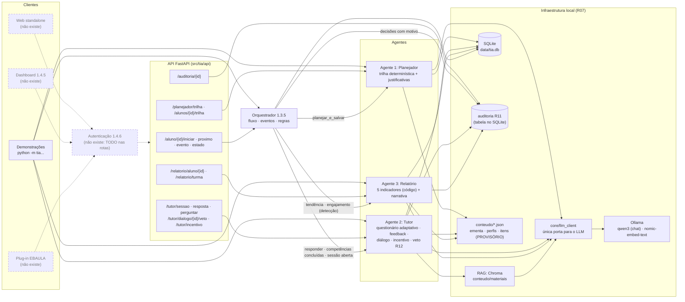
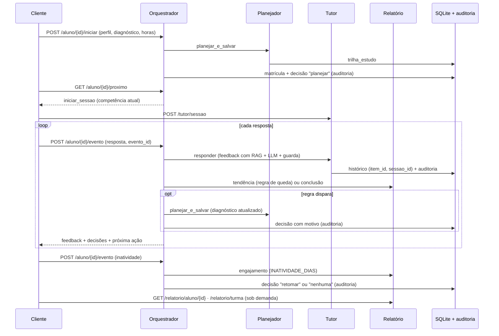

# Arquitetura do Sistema TIA (EAP 1.3.1) e Orquestração (EAP 1.3.5)

> Protótipo integrado (fatia vertical) da frente A3. Situação em 10/10/2026.
> Dados pedagógicos (ementa, perfis, banco de itens, material) e regras marcadas como
> **PROVISÓRIO** dependem da Pessoa 2 (agentes) e da Pessoa 4 (conteúdo).

## Diagrama

Legenda: caixas com borda contínua **existem** e têm testes. Caixas tracejadas **ainda não existem**.

## O que existe e o que não existe

| Parte | Situação |
|---|---|
| LLM local (Ollama, qwen3) via `core/llm_client` | **Real** (R07: nunca API externa) |
| RAG (Chroma + nomic-embed-text) | **Real**. O material é PROVISÓRIO (Pessoa 4) |
| Agente 1 Planejador | **Real**. Ementa e perfis são PROVISÓRIOS |
| Agente 2 Tutor (questionário, feedback com guarda, diálogo, incentivo, veto R12) | **Real**. O banco de itens é PROVISÓRIO |
| Agente 3 Relatório (5 indicadores, narrativa com guarda) | **Real**. Os indicadores são PROVISÓRIOS |
| Orquestrador (este documento) | **Real**. As regras são PROVISÓRIAS |
| Auditoria (R11) | **Real** (tabela `auditoria`, `GET /auditoria/{id}`) |
| API FastAPI | **Real**, **sem autenticação** (TODO 1.4.6 nas rotas) |
| Autenticação de aluno/docente (1.4.6) | **Não existe** |
| Web standalone (`web/`) | **Não existe** |
| Dashboard institucional (1.4.5, `dashboard/`) | **Não existe**. Vai consumir o JSON de `/relatorio/...` |
| Plug-in EBAULA (`plugin-ebaula/`) | **Não existe** |
| VM institucional (medição do R09) | **Não disponível**. Os tempos foram medidos em notebook (CPU) |

## Fluxo de dados do aluno (orquestrado)

- **Abertura de sessão:** `POST /tutor/sessao`, a rota do Tutor. O `proximo` informa a competência.
- **Respostas:** vão por `POST /aluno/{id}/evento`, para o orquestrador avaliar as regras. Uma resposta
  enviada direto a `/tutor/resposta` funciona, mas não passa pelas regras de replanejamento.
- **Veto docente (R12):** fica na rota do Tutor, `PATCH /tutor/dialogo/{id}/veto`, e aparece no fluxo por
  `GET /aluno/{id}/estado`: `dialogos_vetados` e `rotas.veto_docente`. O histórico do diálogo
  (`rotas.historico_dialogo`) já devolve a correção do docente no lugar da resposta vetada.
- **Idempotência:** cada evento tem um `evento_id`. Reenviar o mesmo id devolve o resultado gravado
  (`repetido: true`) sem chamar o Tutor nem o Planejador de novo. Se o processamento falha (ex.:
  resposta fora de ordem), a reserva é desfeita e o evento pode ser reenviado.

## Regras de replanejamento (todas PROVISÓRIAS)

Código: `src/tia/orquestrador/regras.py`, o único lugar com as regras. Os limiares estão em
`src/tia/core/config.py` (lidos do `.env`).

| Regra | Dispara quando | Ação | Efeito no diagnóstico enviado ao Planejador | Limiares (config) |
|---|---|---|---|---|
| R1 conclusão | A sessão do Tutor na competência foi concluída (2 acertos seguidos no nível 3) e essa conclusão ainda não foi tratada | `avancar` | Nenhum: o Planejador não conhece etapas concluídas (a conclusão fica nas sessões do Tutor). A trilha é refeita com o diagnóstico atual | (critério de conclusão do Tutor) |
| R2 queda | A tendência do Relatório está "caindo" (última sessão contra as anteriores; sem sessão, janela de respostas), a sessão atual ainda não causou reforço e houve respostas suficientes desde o último reforço | `reforcar` | Nota da competência = taxa de acerto observada nela. Pré-requisitos diretos **não concluídos** recebem `ORQ_NOTA_PREREQ_REFORCO`; os que o perfil tinha dispensado voltam à trilha, antes da competência | `RELATORIO_TENDENCIA_LIMIAR=0.15`, `RELATORIO_TENDENCIA_MIN_RESPOSTAS=3`, `RELATORIO_TENDENCIA_JANELA=5`, `ORQ_QUEDA_RESPOSTAS_ENTRE_REPLANOS=5`, `ORQ_NOTA_PREREQ_REFORCO=0.0` |
| R3 inatividade | O engajamento do Relatório marca o aluno como inativo e ainda não houve replanejamento por inatividade depois da última atividade | `retomar` | Nenhum: a trilha é refeita a partir de hoje (semanas recontadas) | `INATIVIDADE_DIAS=3` |

- **Próxima ação** (`GET /proximo`), por prioridade:
  1. `replanejar`: R3 pendente; o cliente envia o evento "inatividade";
  2. `concluido`;
  3. `continuar_sessao`: há sessão aberta na competência atual;
  4. `iniciar_sessao`: competência atual = primeira etapa não concluída da trilha.
- **Decisões:** toda decisão (`planejar`, `avancar`, `reforcar`, `retomar` ou `nenhuma`) vai para
  `orquestrador_decisoes` e para a auditoria, com a regra e o motivo no campo `motivo`. A decisão
  "nenhuma" é gravada quando um evento explícito (conclusão, inatividade) é avaliado e não replaneja. A
  cada resposta comum, não grava nada.

## Tabelas acrescentadas (só CREATE TABLE / ADD COLUMN)

- `orquestrador_matriculas`: perfil, horas e diagnóstico do aluno. O Planejador não grava o diagnóstico,
  e sem ele não daria para replanejar.
- `orquestrador_eventos`: `evento_id` e resultado (idempotência).
- `orquestrador_decisoes`: regra, ação, competência, motivo, se replanejou, evento e sessão.
- `auditoria.motivo`: motivo de cada decisão.

## Limitações conhecidas

- **O Planejador refaz a trilha do zero.** Ele não recebe as etapas concluídas, então "replanejar" só
  muda a composição da trilha (o que o perfil dispensa ou não, pelas notas) e recalcula as semanas.
  Por isso a R1 hoje não muda as etapas.
- **A abertura de sessão não passa pelo orquestrador.** O cliente chama `/tutor/sessao`. Uma sessão
  aberta numa competência que não é a atual não é impedida.
- **A sessão abandonada continua aberta** quando a R2 traz um pré-requisito para antes dela. Ela é
  retomada (`continuar_sessao`) quando a competência volta a ser a atual.
- **Não há agendamento:** a inatividade só é avaliada quando alguém envia o evento ou consulta
  `proximo` / `estado`.
